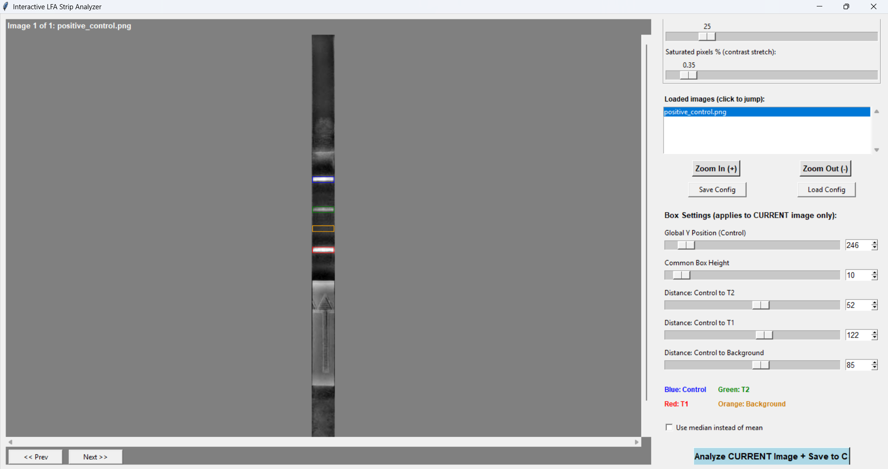

# LFA-Analyzer: Lateral Flow Assay Band Intensity Measurement & Quantification Tool

[](https://www.python.org/)
[](https://docs.python.org/3/library/tkinter.html)
[](https://numpy.org/)
[]()
[]()

---

## 1. Overview & Research Background

**LFA-Analyzer** is a custom image-analysis application developed to objectively measure and quantify **band intensities** from digital photographs of lateral flow assay (LFA) dipsticks and test cassettes.

Lateral flow dipsticks (LFDs) are widely used for rapid point-of-care (POC) molecular and immunological diagnostics. While traditionally interpreted by subjective eye inspection (yes/no), qualitative scoring is prone to user bias, struggles with faint bands near the limit of detection, and cannot quantify reaction kinetics or multi-target competition.

LFA-Analyzer solves this by performing **linear pixel-intensity measurements** (reported in arbitrary units, a.u.) on digital images of developed strips. It extracts background-subtracted **net band intensities** and computes normalized **test-to-control ($T/C$) relative intensity ratios**, providing objective, publication-grade quantitative data.

<p align="center">
  
</p>
<p align="center"><em>Figure 1: LFA-Analyzer graphical interface showing full-width ROI integration boxes (Control: Blue, T2: Green, T1: Red, Local Background: Orange), dynamic distance controls, zoom controls, and real-time contrast preview.</em></p>

---

## 2. Real-World Application: Multiplex HPV Isothermal Detection

LFA-Analyzer was specifically designed and used to quantify results in the research study:
> **"Multienzyme Isothermal Rapid Amplification-coupled Lateral Flow Assay for Point-of-Care Cervical Cancer Diagnosis through High-Risk Human Papillomavirus Detection"**  
> *Author: Md Abu Sadat Soash | Supervisor: Prof. Dr. Gokul Chandra Biswas*  
> *Department of Genetic Engineering and Biotechnology, Shahjalal University of Science and Technology (SUST), Sylhet, Bangladesh.*

In this research, a duplex Multienzyme Isothermal Rapid Amplification (MIRA) assay coupled to a lateral flow dipstick (LFD) was engineered for simultaneous point-of-care detection of **HPV-16 (Test Line 1, T1)** and **HPV-18 (Test Line 2, T2)** E6 oncogenes. LFA-Analyzer provided the experimental band quantification across all key validation stages:

1. **Elimination of Primer-Dimer False Positives**:
   - Quantified the zero-signal baseline on No-Template Controls (NTC) achieved by the internal Endonuclease IV (NFO) probe system versus intense false-positive bands in early dual-labeled primer designs.
2. **Reaction Temperature Optimization (30 °C, 37 °C, 42 °C)**:
   - Measured net band intensity across temperatures, demonstrating that physiological body heat ($37\ ^\circ\text{C}$) yields optimal, high-intensity bands within 30 minutes, while also documenting detectable signal at ambient room temperature ($30\ ^\circ\text{C}$).
3. **Incubation Time Kinetics (10, 20, 30 min)**:
   - Tracked the emergence and saturation of T1 and T2 band intensities over time, verifying positive visual detection within 10–20 minutes and peak line contrast at 30 minutes.
4. **Analytical Sensitivity & Limit of Detection (LOD)**:
   - Quantified band intensities across template dilutions (1 to 100 copies/µL), verifying a stable analytical limit of detection of **10 copies/µL** for both HPV genotypes.
5. **Duplex Channel Competition**:
   - Assessed simultaneous amplification and relative intensity ratios ($R_{T1/C}$ and $R_{T2/C}$) under target competition.

Downstream statistical analysis and graphical representations of the quantified LFA data were plotted in **GraphPad Prism** (version 8.4.2) and Python.

---

## 3. Band Intensity Measurement Methodology

### 3.1 Image Acquisition Setup
Strips are photographed under uniform diffuse illumination against a white background (e.g., using a mirrorless camera such as the Sony Alpha 6400 with a 24.2 MP APS-C CMOS sensor in automatic mode, or a calibrated mobile setup). Images are evaluated without cropping or contrast manipulation so the linear pixel values directly represent physical sensor reflectance.

### 3.2 Four Full-Width Regions of Interest (ROIs)
For each strip, four rectangular regions of interest of equal height are defined:
* **Control Line ($C$, Blue)**: Anchoring reference position.
* **Test Line 2 ($T2$, Green)**: Captures HPV-18 amplicons via anti-digoxigenin antibody.
* **Test Line 1 ($T1$, Red)**: Captures HPV-16 amplicons via streptavidin (biotin).
* **Local Background ($BG$, Orange)**: A band-free region of the nitrocellulose membrane.

All four regions span the **full width of the strip**. Because band migration and spacing are fixed by the strip manufacturing process, the four ROIs are anchored to a single Control-line $Y$-coordinate with fixed inter-line offsets ($\Delta Y_{T2}$, $\Delta Y_{T1}$, $\Delta Y_{\text{BG}}$), ensuring strict geometric consistency across strips.

### 3.3 Median Pixel Intensity Integration
Within each full-width ROI slit, pixel intensity is integrated. The **median pixel intensity** is utilized as the default metric:
$$I_{\text{raw}} = \text{median}\left(\mathbf{I}_{\text{ROI}}\right)$$
*Why median?* The median provides robust resistance against localized outliers, dust particles, membrane surface grain, and specular reflections that would otherwise skew the arithmetic mean. (Mean calculation is also selectable if desired).

### 3.4 Net Band Intensity (Background Subtraction)
In standard colorimetric lateral flow dipsticks using colloidal gold nanoparticles (AuNPs), captured bands appear **darker** than the white/light nitrocellulose membrane. Consequently:
$$\Delta I_{\text{Control}} = I_{\text{Background}} - I_{\text{Control}}$$
$$\Delta I_{T1} = I_{\text{Background}} - I_{T1}$$
$$\Delta I_{T2} = I_{\text{Background}} - I_{T2}$$

* **Net intensity increases directly with band darkness / gold accumulation.**
* A net value of **0** indicates a line indistinguishable from the blank nitrocellulose membrane.

### 3.5 Relative Intensity (% Test-to-Control Ratio)
To compensate for minor strip-to-strip variations in sample volume, liquid migration, capillary wicking speed, or gold-conjugate release, test line signals are normalized against the internal control line:

$$\text{Relative Intensity } T_1 \, (\%) = \frac{\Delta I_{T1}}{\Delta I_{\text{Control}}} \times 100\%$$

$$\text{Relative Intensity } T_2 \, (\%) = \frac{\Delta I_{T2}}{\Delta I_{\text{Control}}} \times 100\%$$

This yields the **$T/C$ ratio (%)**, providing a standardized, unitless metric for cross-strip and cross-batch comparison.

### 3.6 Color Channel Deconvolution
Colloidal gold nanoparticles absorb light strongly around 520–540 nm (green spectrum). LFA-Analyzer allows users to measure in:
* **Luminance (Default Grayscale)**: Standard overall brightness.
* **Green Channel**: Maximizes contrast and signal-to-noise ratio for red/pink colloidal gold bands.
* **Red or Blue Channels**: For alternative colorimetric labels (e.g., blue latex beads).

### 3.7 Visual Enhancement vs. Raw Precision
LFA-Analyzer strictly decouples preview visualization from measurement calculation:
* **Display Enhancement**: Background-flattening (box blur) and contrast-stretching operate strictly on an 8-bit display buffer to assist the user in identifying and aligning faint bands on-screen.
* **Calculation Array**: The underlying measurement is computed on the unaltered, full-precision `float64` array loaded directly from the original image file.

---

## 4. Software Architecture & Workflow

```text
┌───────────────────────────────────────────────────────────────────┐
│                    1. Image Capture / Input                       │
│  Developed LFA strip photograph under uniform diffuse lighting    │
└─────────────────────────────────┬─────────────────────────────────┘
                                  │
                                  ▼
┌───────────────────────────────────────────────────────────────────┐
│          (Optional) Perspective Correction via Fiji Plugin        │
│  Fiji/plugins/Four_Point_Crop.py: Straightens angled photographs  │
└─────────────────────────────────┬─────────────────────────────────┘
                                  │
                                  ▼
┌───────────────────────────────────────────────────────────────────┐
│               2. LFA-Analyzer GUI (strip_analyzer.py)             │
│  • Load single or batch images                                    │
│  • Align Control Y-slider (T2, T1, BG boxes follow automatically) │
│  • Set box height (H) and inter-line distances                    │
│  • Select channel (Luminance / Green / Red / Blue)                │
│  • Select statistic (Median / Mean)                               │
└─────────────────────────────────┬─────────────────────────────────┘
                                  │
                                  ▼
┌───────────────────────────────────────────────────────────────────┐
│                   3. Band Intensity Quantification                │
│  • Computes Raw Values: C, T1, T2, BG                             │
│  • Calculates Net Intensities: ΔI = I_bg - I_band                 │
│  • Calculates Relative Intensities: T/C Ratio (%)                 │
└─────────────────────────────────┬─────────────────────────────────┘
                                  │
                                  ▼
┌───────────────────────────────────────────────────────────────────┐
│                       4. Output & Telemetry                       │
│  • Real-time Matplotlib bar plots (Net Intensity & T/C Ratio)     │
│  • Automatic CSV export for GraphPad Prism / Excel analysis       │
└───────────────────────────────────────────────────────────────────┘
```

---

## 5. Usage Guide

### 5.1 Installation & Requirements

Ensure you have Python 3.10+ installed. Install the dependencies:

```bash
git clone https://github.com/Soash/lfa-analyzer.git
cd lfa-analyzer
pip install -r requirements.txt
```

#### Dependencies:
* `numpy` (array manipulation, median/mean statistics)
* `pillow` (image loading and color channel extraction)
* `matplotlib` (immediate diagnostic visualization of bar charts)
* `tkinter` (standard Python GUI library)

### 5.2 Running the Application

Launch the analyzer with:
```bash
python strip_analyzer.py
```

### 5.3 Step-by-Step Operation:
1. **Load Images**: Click **1. Load Image(s)** and select one or multiple strip images (PNG, JPG, TIFF, BMP).
2. **Channel Selection**: In the right panel, select **Measure channel** (`Luminance` or `Green` recommended for colloidal gold).
3. **Align ROIs**:
   - Adjust **Global Y Position (Control)** until the blue box aligns centered on the Control line.
   - Adjust **Common Box Height** to cover the vertical thickness of the band without clipping into adjacent zones.
   - Adjust **Distance: Control to T2**, **Distance: Control to T1**, and **Distance: Control to Background** to position the green, red, and orange boxes over their respective bands and blank membrane.
   - *Tip*: You can drag directly on the canvas to move the control box.
4. **Choose Metric**: Keep **Use median instead of mean** checked (recommended for dust/glare immunity).
5. **Analyze & Export**:
   - **Analyze CURRENT Image**: Displays interactive bar charts and appends the measurement row to your selected CSV file.
   - **Analyze ALL Loaded Images**: Batch-processes all loaded images in sequence using their configured coordinates.
   - CSV output records: `filename`, `stat_used`, `control_raw`, `t1_raw`, `t2_raw`, `background_raw`, `control_net`, `t1_net`, `t2_net`, `t1_c_ratio`, `t2_c_ratio`, and spatial coordinates.

---

## 6. Optional Pre-Processing: Fiji 4-Point Cropping

If your raw photographs are taken at an angle or with phone perspective distortion:
1. Open the raw image in [Fiji / ImageJ](https://fiji.sc/).
2. Run `Fiji/plugins/Four_Point_Crop.py` from the Fiji Script Editor or plugins folder.
3. Use the **Multi-point Tool** to click the 4 corners of the strip membrane (Top-Left, Top-Right, Bottom-Right, Bottom-Left).
4. The plugin applies planar homography rectification and saves a straightened, orthogonal rectangular strip ready for LFA-Analyzer.

---

## 7. Repository Organization

```text
lfa-analyzer/
├── strip_analyzer.py            # Main interactive Tkinter band intensity analyzer
├── demo.png                     # Interface screenshot with ROI overlays
├── requirements.txt             # Python dependencies (numpy, pillow, matplotlib)
├── Fiji/
│   └── plugins/
│       └── Four_Point_Crop.py   # Fiji/ImageJ helper plugin for 4-point perspective crop
├── .gitignore                   # Git exclusion rules
└── README.md                    # Project documentation
```

---

## 8. Authorship & Citation

* **Developer:** **Md Abu Sadat Soash**  
  *Department of Genetic Engineering and Biotechnology*  
  *Shahjalal University of Science and Technology (SUST), Sylhet, Bangladesh*  
  *Email:* [mdabu13@student.sust.edu](mailto:mdabu13@student.sust.edu)
* **Research Supervisor:** **Prof. Dr. Gokul Chandra Biswas**  
  *Department of Genetic Engineering and Biotechnology, SUST, Bangladesh*

If you use or adapt LFA-Analyzer in your lateral flow or diagnostic assay research, please cite:
> Soash, M. A. S., & Biswas, G. C. (2026). *Multienzyme Isothermal Rapid Amplification-coupled Lateral Flow Assay for Point-of-Care Cervical Cancer Diagnosis through High-Risk Human Papillomavirus Detection*. Bachelor of Science (Honours) Thesis, Department of Genetic Engineering and Biotechnology, Shahjalal University of Science and Technology.
